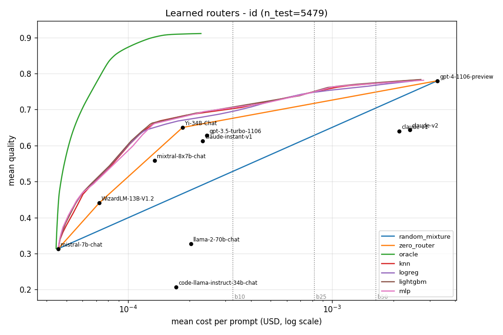

# cascade-router

A learned router that decides, **per query**, which LLM (from cheap to expensive) to use,
maximising answer quality per dollar. Evaluated **offline** on RouterBench precomputed LLM
outputs; served via a FastAPI endpoint on CPU.

> Portfolio project · Python 3.11 · free/CPU-only · [maha012002/cascade-router](https://github.com/maha012002/cascade-router)

---

## Problem

For each prompt \(x\) and model \(m\), RouterBench gives a quality score \(q(x,m)\) and a cost
\(c(x,m)\). A router picks

\[
m^*(x) = \arg\max_m \big[ \hat{q}(x,m) - \lambda \cdot \hat{c}(x,m) \big].
\]

Sweeping \(\lambda\) traces a **cost–quality curve**. We compare routers by that curve (area under
it, quality at fixed budgets, cost to reach 95% of the best single model's quality).

## Why it matters

Calling GPT-4 on every prompt is expensive; calling Mistral-7B on every prompt wastes quality.
On RouterBench (0-shot), GPT-4 costs about **72×** Mistral-7B on average, while the cheapest model
already matches the best achievable quality on **31.2%** of prompts ([data card](docs/DATA_CARD.md)).
A good router should spend up only when the prompt needs it.

## Data

| | |
|---|---|
| Source | [withmartian/routerbench](https://huggingface.co/datasets/withmartian/routerbench) (Hu et al., 2024, [arXiv:2403.12031](https://arxiv.org/abs/2403.12031)) |
| File used | `routerbench_0shot.pkl` at pinned revision `78402148…` |
| Scale | **36,497** prompts × **11** LLMs → 401,467 outcome rows |
| Quality | Mostly binary 0/1; GSM8K / MT-Bench graded in [0, 1] |
| Licence | **Not declared** on the Hub card — we do **not** redistribute the data |

Families: MMLU, HellaSwag, GSM8K, ARC-Challenge, WinoGrande, MBPP, MT-Bench, plus a `misc` bucket.
Full schema, costs, and caveats (including degenerate Llama-2 MMLU responses): **[docs/DATA_CARD.md](docs/DATA_CARD.md)**. Third-party credits: **[NOTICE.md](NOTICE.md)**.

## Method

1. **Leakage-safe splits** — near-duplicate prompts (TF-IDF cosine ≥ 0.7) form groups; we split by
   group. Two protocols: in-distribution 70/15/15, and leave-one-benchmark-out (LOBO).
   ([ADR 0002](docs/decisions/0002-split-protocol.md))
2. **Features** — cached `all-MiniLM-L6-v2` embeddings (384-d) + 9 handcrafted signals (length,
   code, digits, MCQ markers, …). ([ADR 0004](docs/decisions/0004-embeddings-and-per-model-predictors.md))
3. **Per-model predictors** — for each of 11 LLMs, predict expected quality in [0, 1] (soft-label
   cross-entropy). Families: kNN, logistic regression, LightGBM, small MLP.
   *Why not predict “best model”?* Routing needs both quality **and** cost; a single discrete
   label cannot trade off \(\lambda\).
4. **Policy** — \(m^* = \arg\max_m[\hat q - \lambda \hat c]\). Cost at route time is predicted from
   prompt length (output tokens unknown online).
5. **Chosen router for serving: LightGBM** (best ID AUC; small artifact).
   ([ADR 0005](docs/decisions/0005-chosen-router.md))

## Baselines

All model choices that need statistics are made on **train**, never test ([ADR 0003](docs/decisions/0003-evaluation-protocol.md)):

| Baseline | Meaning |
|---|---|
| Always-best | Always route to the train-best mean-quality model (usually GPT-4) |
| Random mixture | Mix always-cheapest and always-best |
| Zero router | Mix models on the **train** single-model cost–quality hull (strongest prompt-agnostic baseline) |
| Oracle | Upper bound: route with *true* \(q\) and \(c\) (exact frontier) |

## Results (measured)

Numbers from `make train` / `make baselines`. Full tables: [docs/results/](docs/results/).

### In-distribution test (n = 5,479)

| Method | AUC | Quality @ 10% cost | @ 25% | @ 50% | Cost to 95% of best (÷ best cost) |
|---|---|---|---|---|---|
| Random mixture | 0.547 | 0.354 | 0.425 | 0.543 | 0.918 |
| Zero router | 0.706 | 0.656 | 0.677 | 0.711 | 0.716 |
| Logistic regression | 0.753 | 0.695 | 0.748 | 0.767 | 0.211 |
| MLP | 0.756 | 0.703 | 0.749 | 0.773 | 0.221 |
| kNN | 0.756 | 0.702 | 0.749 | 0.773 | 0.224 |
| **LightGBM** | **0.757** | **0.702** | **0.750** | **0.774** | **0.220** |
| Oracle | 0.908 | 0.911 | 0.911 | 0.911 | 0.020 |

LightGBM closes **~25%** of the zero-router → oracle gap on ID.

### Leave-one-benchmark-out (mean AUC)

| Method | Mean LOBO AUC |
|---|---|
| Zero router | 0.660 |
| Logistic regression | 0.666 |
| MLP | 0.677 |
| **LightGBM** | 0.683 |
| **kNN** | **0.687** |
| Oracle | 0.898 |

On **Winogrande held-out**, every learned router is *below* the zero router (≈0.69–0.70 vs 0.716) —
lexical twins dominate that fold; prompt-agnostic ranking wins there.

### Cost–quality plot (ID)



## Calibration

ECE on ID test for LightGBM is already **0.0087**. Isotonic / temperature drive val ECE ≈ 0 but
**do not raise** routing AUC (0.757 → 0.754 / 0.757). We serve **uncalibrated** scores.
Details: [docs/results/m3_calibration_summary.md](docs/results/m3_calibration_summary.md).

## Error analysis

At λ ≈ 40 (~25% of always-best cost), LightGBM vs oracle on ID — mean quality gap by source:

| Source | Mean quality gap (oracle − router) |
|---|---|
| winogrande | 0.204 |
| mmlu | 0.199 |
| mbpp | 0.169 |
| hellaswag | 0.166 |
| gsm8k | 0.109 |
| arc_challenge | 0.068 |

**Costliest mistakes:** routing to GPT-4 when a cheaper model already matched quality — especially
`chinese-remainder-theorem` and MT-Bench (extra ~$0.02–0.04/prompt for no gain).
Write-up: [docs/results/m3_error_analysis.md](docs/results/m3_error_analysis.md).

## Serving

```bash
make artifact   # once: train LightGBM on ID -> artifacts/serve/lightgbm-id-v1/
make serve      # http://127.0.0.1:8000
# or: make docker-run
```

| Endpoint | Behaviour |
|---|---|
| `GET /health` | status, `router_version`, model count |
| `POST /route` | `{prompt, lambda? \| budget?}` → chosen model, per-model \(\hat q\), expected costs |

**Measured CPU latency** (n=30 timed routes, cache off): **p50 = 16.3 ms**, **p95 = 18.6 ms**.
Optional Redis via `CACHE_REDIS_URL`; otherwise an in-process cache. ([ADR 0006](docs/decisions/0006-serving.md))

## Limitations

- **Offline-only evaluation** — we never call live LLMs; labels and costs are from RouterBench.
- **Benchmark ≠ production traffic** — prompt mix, length, and domain will differ.
- **Quality ≠ user satisfaction** — labels are benchmark correctness / grades, not preference.
- **Graded GSM8K** is not binary correctness (see data card).
- **Some labels reflect harness failures** (e.g. Llama-2 emitting `"\nAnswer"` on MMLU).
- **OOD is hard** — Winogrande LOBO shows learned routers can lose to a strong zero router.

## Reproduce

```bash
python -m venv .venv          # Python 3.11
# Windows: .venv\Scripts\activate
make setup
make data                     # Hub download @ pinned revision
make splits
make baselines
make embed                    # needs ≥ ~3 GiB free RAM (gated)
make train
make calibrate
make errors
make artifact
make test
make serve                    # then POST /route
make bench
```

MLflow (local SQLite): `make mlflow-ui` → http://127.0.0.1:5000  
No `make`? Each target is a one-liner in the `Makefile` (e.g. `python -m router.data`).

Configs live under `configs/`; design notes under `docs/decisions/`; session log: `LOG.md`.

## Future work

- **Live cascade** with local models via `llama.cpp` / vLLM (replace offline labels with real generations).
- **Online learning** from thumbs-up / edit feedback to update \(\hat q\).
- **Drift detection** on prompt embedding distribution and on realised cost/quality.
- Stronger OOD routers (domain adapters, separate heads per benchmark family).

## License

Copyright (c) 2026 maha012002. **All rights reserved.** Public for viewing and evaluation only —
no copy/modify/reuse without written permission. See [LICENSE](LICENSE).
