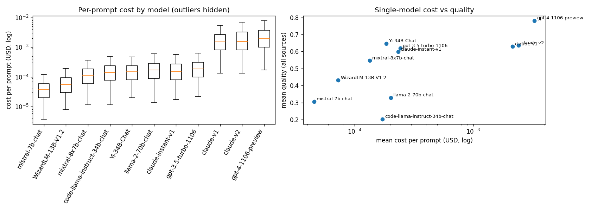

# Data card: RouterBench (as used by cascade-router)

All numbers below come from `make data` + `notebooks/01_eda.ipynb` on the pinned revision.
Re-run those to regenerate them.

## Source

| Field | Value |
|---|---|
| Hub location | [`withmartian/routerbench`](https://huggingface.co/datasets/withmartian/routerbench) (dataset repo) |
| Pinned revision | `784021482c3f320c6619ed4b3bb3b41a21424fcb` (last modified 2024-03-27) |
| Files on the Hub | `routerbench_0shot.pkl` (99.6 MB), `routerbench_5shot.pkl` (171.1 MB), `routerbench_raw.pkl` (1.20 GB, not downloaded) |
| Format | **Python pickle of a pandas DataFrame** (not Parquet/CSV) |
| Licence | **Not declared.** Neither the Hub card metadata nor the README states a licence. The underlying benchmarks carry their own licences. We do not redistribute the data (`data/` is git-ignored); check terms before any redistribution. |
| Paper | Hu et al., 2024, "RouterBench: A Benchmark for Multi-LLM Routing System" |

**Security note:** unpickling can execute arbitrary code. We only unpickle files from the pinned
revision, once, and convert them to Parquet; everything downstream reads Parquet.

## Which file we use

We use **`routerbench_0shot.pkl`** as the primary file (`configs/data.yaml: primary_file`):

- 0-shot: 36,497 rows, `sample_id` unique, **no nulls**.
- 5-shot: 36,511 rows, **14 duplicated `sample_id`s** (the ones inspected are ARC-Challenge) and **14 all-NaN quality rows**.
- The two files have the same set of `sample_id`s. Quality labels are **identical** except on the
  multiple-choice sources (MMLU, HellaSwag, Winogrande, ARC-Challenge), where 18–40% of
  (prompt, model) cells differ, depending on the eval.

## Raw schema (wide: one row per prompt, 37 columns)

| Column | Type | Meaning |
|---|---|---|
| `sample_id` | str | Unique prompt id, e.g. `grade-school-math.dev.0` → our `prompt_id` |
| `prompt` | str | **Stringified Python list** of parts, e.g. `"['instruction', 'question']"`. Parsed with `ast.literal_eval` and joined with blank lines |
| `eval_name` | str | Fine-grained task (86 distinct values) |
| `<model>` ×11 | object (floats) | Quality score in [0, 1] |
| `<model>\|model_response` ×11 | str | Generated text (dropped from the tidy table) |
| `<model>\|total_cost` ×11 | float64 | Estimated USD cost of that call (varies per prompt, so it is token-based) |
| `oracle_model_to_route_to` | str | Precomputed oracle label (dropped; we compute our own oracle in M1) |

## Tidy outputs (`data/processed/`)

- `outcomes.parquet`: `prompt_id, source, eval_name, model, quality, cost`. **401,467 rows**
  (36,497 prompts × 11 models). Validated: no duplicates, no nulls, quality ∈ [0, 1], cost > 0,
  every prompt has all 11 models.
- `prompts.parquet`: `prompt_id, source, eval_name, prompt` with 36,497 rows.

## Models (11)

Ordered by mean cost per prompt (all sources):

| Model | Mean cost (USD) | × cheapest | Mean quality |
|---|---|---|---|
| mistralai/mistral-7b-chat | 0.000046 | 1.0 | 0.306 |
| WizardLM/WizardLM-13B-V1.2 | 0.000073 | 1.6 | 0.431 |
| mistralai/mixtral-8x7b-chat | 0.000135 | 2.9 | 0.547 |
| meta/code-llama-instruct-34b-chat | 0.000172 | 3.8 | 0.202 |
| zero-one-ai/Yi-34B-Chat | 0.000186 | 4.1 | 0.647 |
| meta/llama-2-70b-chat | 0.000203 | 4.4 | 0.329 |
| claude-instant-v1 | 0.000233 | 5.1 | 0.598 |
| gpt-3.5-turbo-1106 | 0.000243 | 5.3 | 0.619 |
| claude-v1 | 0.002145 | 46.9 | 0.630 |
| claude-v2 | 0.002419 | 52.9 | 0.636 |
| gpt-4-1106-preview | 0.003293 | 72.0 | 0.781 |

There are two price tiers: eight models at ≤ $0.00025 per prompt and three (Claude v1/v2,
GPT-4) at roughly 10× more. Per prompt, the most expensive model costs a median of **50.7×** the
cheapest (5th–95th percentile: 50.2×–119.1×, max 1525.7×). Running every prompt through GPT-4
costs $120.18, versus $1.67 for Mistral-7B.

## Source benchmarks

`source` is our coarse grouping of `eval_name` (`router.data.source_from_eval_name`):

| source | prompts | eval_names | Quality grading |
|---|---|---|---|
| mmlu | 14,042 | 57 subjects | binary 0/1 |
| hellaswag | 10,042 | 1 | binary 0/1 |
| gsm8k (`grade-school-math`) | 7,450 | 1 | **graded**: {0, .25, .5, .75, 1}; only 0.8% of cells are 0 or 1 |
| misc | 1,719 | 21 | mostly binary (84.3% of cells), some graded |
| arc_challenge | 1,470 | 1 | binary 0/1 |
| winogrande | 1,267 | 1 | binary 0/1 |
| mbpp | 427 | 1 | binary 0/1 |
| mtbench | 80 | 3 (`mtbench`, `-math`, `-reference`) | **graded** in tenths (0.1–1.0) |

`misc` includes Chinese-language tasks (riddles, poetry, idioms, zodiac, …), `consensus_summary`,
`bias_detection`, `abstract2title`, `accounting_audit`, `chinese-remainder-theorem` and a 3-row
`test-match` smoke test. These names *look like* tasks from the OpenAI `evals` registry; **this is
unverified.** The paper's RAG subset is not visible as a separate `eval_name` in this file.

## Missing values and duplicates

- 0-shot file: **0 nulls** in any column; `sample_id` unique.
- **16 prompt texts appear twice** under different `sample_id`s (32 rows: `consensus_summary` 8,
  `mbpp` 4, a few MMLU and misc). For **15 of 176** (duplicate text, model) pairs, the two copies
  carry **different quality labels**. This is direct evidence of label noise, and it causes
  train/test leakage if the copies are split apart (handled in M1).

## Label caveats (important for interpreting any result)

1. **GSM8K quality is not correctness.** It is a graded score (likely a rubric or LLM judge;
   provenance not documented in the card). In inspected examples, two models giving the same
   correct final answer (72) received 0.75 and 0.5. Treat GSM8K quality as a noisy graded score.
2. **Degenerate generations are in the labels.** On MMLU, the most frequent raw response is
   `"\nAnswer"` for Llama-2-70B (92.6% of MMLU prompts) and Code-Llama-34B (79.9%), giving
   far-below-chance MMLU quality (0.027 and 0.005). Mistral-7B answers `"\nA"` on 77.4% and scores
   0.254, which is chance level. These reflect the generation harness and formatting, not model
   knowledge. A router can learn "never send MMLU to Llama-2", but that conclusion would not
   transfer to a better-prompted deployment.
3. Quality labels are benchmark correctness or grades, not user satisfaction.

## EDA answers (headline numbers)

- **Best model per source:** GPT-4 has the best mean quality on 7/8 sources. On GSM8K, Claude v2
  (0.663) edges GPT-4 (0.659) by 0.004, which is within noise of the graded labels.
  Overall: GPT-4 0.781, then Yi-34B 0.647 (at 4.1× vs 72× the cheapest model's cost).
- **Cheapest model already good enough:** Mistral-7B is the per-prompt cheapest on 36,320/36,497
  prompts. On binary sources it is correct on **27.6%** of prompts. Across all sources it already
  matches the best quality any model achieved on **31.2%** of prompts (per-prompt cheapest: 31.3%).
- **Unsolved prompts:** on **3.6%** of prompts every model scores 0 (misc 21.0%, MBPP 13.3%,
  MMLU 4.5%, HellaSwag 2.4%, ARC 1.0%, Winogrande/GSM8K/MT-Bench 0%).
  At least one model scores a perfect 1.0 on **76.4%** of prompts. This is low because GSM8K
  rarely gets 1.0 (3.4%).
- **Cost spread:** see the Models table: 72× between the cheapest and most expensive model on
  average.

